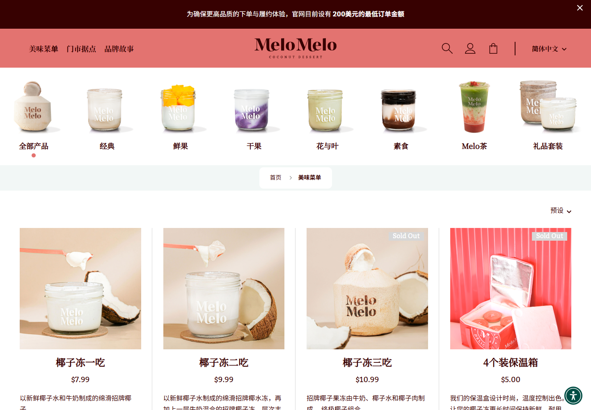

Method: dual-agent (A: /root/visual_review · B: /root/technical_review)

MeloMelo 网站视觉与内容布局分析，2026-11-05。主目标：https://www.melomelo.us/menu 。检查了桌面 1440px、手机 390px、鲜果分类、两款商品详情、排序、手机导航及一次可恢复的加购；另查看首页作为品牌上下文。本次浏览器呈现简体中文，不代表每位访客的默认语言。未购买或提交表单。

**结论：它最值得学习的是产品摄影和品牌一致性；菜单的信息组织与购买引导还有明显改善空间。** 玻璃罐、椰肉、提起椰冻的勺子和暖米色背景共同传达口感、原料与包装，具有明确的品牌归属。通用电商网格承载了这种视觉表达，但不能替代选品逻辑。

**视觉与布局拆解**

| 层面 | 实际观察 | 设计作用 |
|---|---|---|
| 主色 | 珊瑚粉 #E37370，深酒红 #370101，白底；粉色页脚配深绿标题 | 粉色建立甜品印象，深色承担文字和购买操作 |
| 摄影 | 白底分类实物图；暖米色场景产品图，突出罐体、配料、勺子和质地 | 分类图帮助识别，场景图制造食欲 |
| 字体 | 中文品名 CSS 首选 Noto Serif SC；桌面约 24px/30px，手机 18px/21.6px；控件栈含 Kadwa、Noto Sans SC | 衬线品名增加品牌气质，字号区分信息层级；实际字形可能回退 |
| 桌面网格 | 四列、外边距约 48px、商品图约 296px；细分隔线与留白 | 陈列感整齐，视觉主体是照片 |
| 手机网格 | 两列、边距及列间距约 20px、图片 165px；隐藏商品描述 | 提升扫读速度，但牺牲相似产品的比较信息 |
| 详情页 | 桌面左大图、右品名/价格/加购/成分；手机纵向排列 | 先吸引，再提供口味与过敏原信息 |

菜单的阅读顺序是：起订公告 → 品牌导航 → 实物图片分类 → 面包屑 → 排序 → 商品网格 → 显示更多 → 订阅和服务页脚。桌面商品图片从约 y=556 开始，首屏购买按钮尚未进入视野；手机图片从约 y=397 开始。顶部用于品牌和分类的空间较多，适合慢慢浏览，但需要兼顾回头客快速选购。

首页补充了活动订购、鲜果系列、推荐商品、店内生活场景；与菜单共享粉色、实物分类图和字体，品牌表达连贯。首页采用滚动入场，未触发动画的长截图不能用来判定内容缺失。

**做得好的三个地方**

1. 摄影把商品差异可视化：芒果块、果泥、椰冻层次比抽象装饰更有效。
2. 商品比例、标题、价格和购买按钮保持稳定位置，大量商品仍有秩序。
3. 详情提供成分、过敏原、营养资料入口与冷链说明，为购买建立信任。

**优先问题**

1. **[P1] 库存状态和下一步行动矛盾。** 椰子冻三吃、保温箱、玻璃杯同时显示 Sold Out 与禁用的“请至门市”。用户不清楚是官网缺货还是门店专售，也无法直接从按钮查门店。分开“官网暂缺货”和“仅门店供应”，提供可点击的门店入口。对应 `$impeccable clarify`。
2. **[P2] 默认排序混入配件和不可买商品。** 前六项包含三项官网不可买商品，保温箱、玻璃杯打断甜品比较。默认优先可购买招牌甜品，把周边独立分组，并提供“仅看可配送”。对应 `$impeccable distill`。
3. **[P2] 手机的商品差异与分类入口不够明显。** 一吃/二吃价格不同、照片相似，而解释被隐藏；分类后半段需要横滑，缺少清楚的提示。保留一行“纯椰水/双层椰奶/果粒/果泥”等差异标签，分类栏加下一项露出或边缘渐隐。对应 `$impeccable adapt`、`layout`。
4. **[P2] 次要操作不够易用。** 手机收藏约 27×32px、排序约 39×27px；“预设”不如“排序：推荐”直观。手机导航 Escape 不关闭、关闭按钮缺少可访问名称。扩大操作区、补按钮名称与 Escape 行为；44px 是舒适度目标，不据此笼统宣称违反所有 WCAG 条款。对应 `$impeccable harden`。
5. **[P2] 状态文字与页面语义需修正。** 6 个售罄标签白字配 #D7D7D7 背景，检测对比度约 1.4:1；主内容跳转链接指向不存在的 #main-content，页面缺少 main landmark；中文界面仍声明 lang=en。加深状态文字，建立真实可聚焦的主内容目标，并同步语言声明。对应 `$impeccable audit`。

**限定范围的设计评分：23/36（约 64%）**。这是 Assessment A 的人工启发式判断，不是转化率或自动化合规分数；技术发现独立补充，未测试的错误恢复不计入分母。

| 启发式 | 分数 / 4 | 依据 |
|---|---:|---|
| 系统状态 | 3 | 分类选中可见，库存语义有冲突 |
| 现实语言 | 3 | 配料易懂，一吃/二吃仍需解释 |
| 控制与自由 | 3 | 分类、面包屑、排序退出正常；此评分不代表手机导航通过 |
| 一致性 | 2 | Sold Out 与请至门市、中英表达不一致 |
| 错误预防 | 3 | 不可买按钮禁用，详情提供过敏原；交易未全面测试 |
| 识别优于记忆 | 2 | 手机隐藏差异说明和部分分类 |
| 效率 | 2 | 有分类排序，缺少可配送筛选 |
| 美观与精简 | 3 | 摄影稳定，顶部占位和混排影响效率 |
| 错误恢复 | 未测 | 未触发并评估业务错误 |
| 帮助说明 | 2 | 有 FAQ、营养资料；门店行动缺上下文帮助 |

认知负荷中等：分类同级选项多、分类维度混合、手机比较需要记住详情。多于四个选项本身不构成设计错误，此处与横滑发现性及比较信息缺失共同增加负担。初访者容易困惑于一吃/二吃和库存措辞；手机用户受小操作区和隐藏分类影响；边界检查者会遇到“请至门市”动作无法执行。

情绪旅程从照片带来的食欲开始，遇到 200 美元起订和多项不可买商品时产生落差，详情的成分与冷链说明又恢复信任。起订政策是业务条件，不能凭审美判错；设计可在其旁明确提供少量购买的门店入口。未走结账流程，不能评价交易终点体验。详情的“0 则评论”不构成已有社会证明。

**GOOD COCONUT 可以借鉴什么**

保留统一摄影体系、可见配料、实物分类图、清晰价格和品牌字体。首页负责品牌故事，菜单优先帮助用户选到想吃且能买的商品：可买招牌在前、每款保留短口味标签、门店与配送入口明确。不要未经业务确认照搬其 200 美元起订条件、商品排序和库存文案。

**检查边界**

Impeccable 输出 6 个同类对比度发现；CLI 返回了完整 JSON，但包装进程退出码为 1 且无诊断，因此不称为成功合规认证。补充 axe 扫描有 3 类语义问题，涉及重叠节点，不应累加为几十个独立缺陷；incomplete 项不能当成已确认失败。未发现 1440px 与 390px 下的整页横向溢出，独立分类横滑是预期行为。商品详情能加载；加载中占位不计为页面损坏。加购测试商品已移除，没有下单。

证据保存在 melomelo-analysis/visual 与 melomelo-analysis/technical；桌面首屏 desktop-initial.png，手机首屏 mobile-menu-top.png，库存问题 mobile-menu-cards.png。所有主要截图均经过视觉检查。

后续可选择：①提炼可复用的视觉规范，或②制定 GOOD COCONUT 菜单布局；页面倾向可选①保留大图陈列，或②优先紧凑选购。这些是后续设计选项，本次仅完成分析。

## 截图与证据

- [desktop-detail.png](<evidence/visual/desktop-detail.png>)
- [desktop-fruit.png](<evidence/visual/desktop-fruit.png>)
- [desktop-full.png](<evidence/visual/desktop-full.png>)
- [desktop-initial.png](<evidence/visual/desktop-initial.png>)
- [mobile-detail-buy.png](<evidence/visual/mobile-detail-buy.png>)
- [mobile-detail-top.png](<evidence/visual/mobile-detail-top.png>)
- [mobile-menu-cards.png](<evidence/visual/mobile-menu-cards.png>)
- [mobile-menu-top.png](<evidence/visual/mobile-menu-top.png>)

[独立技术检查记录](evidence/technical/report.md)

