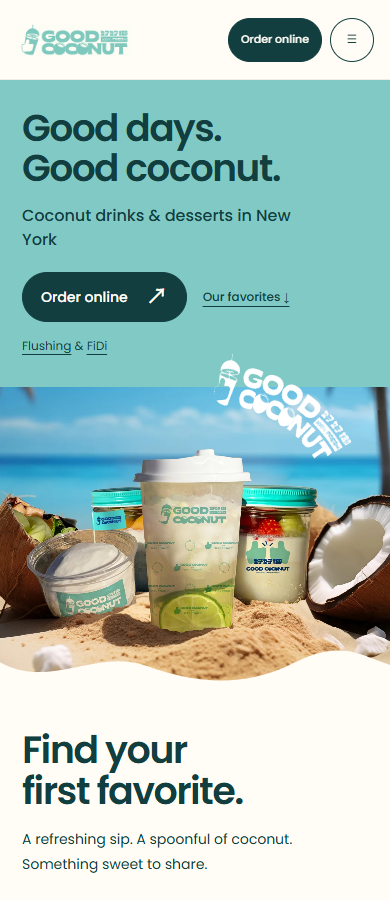
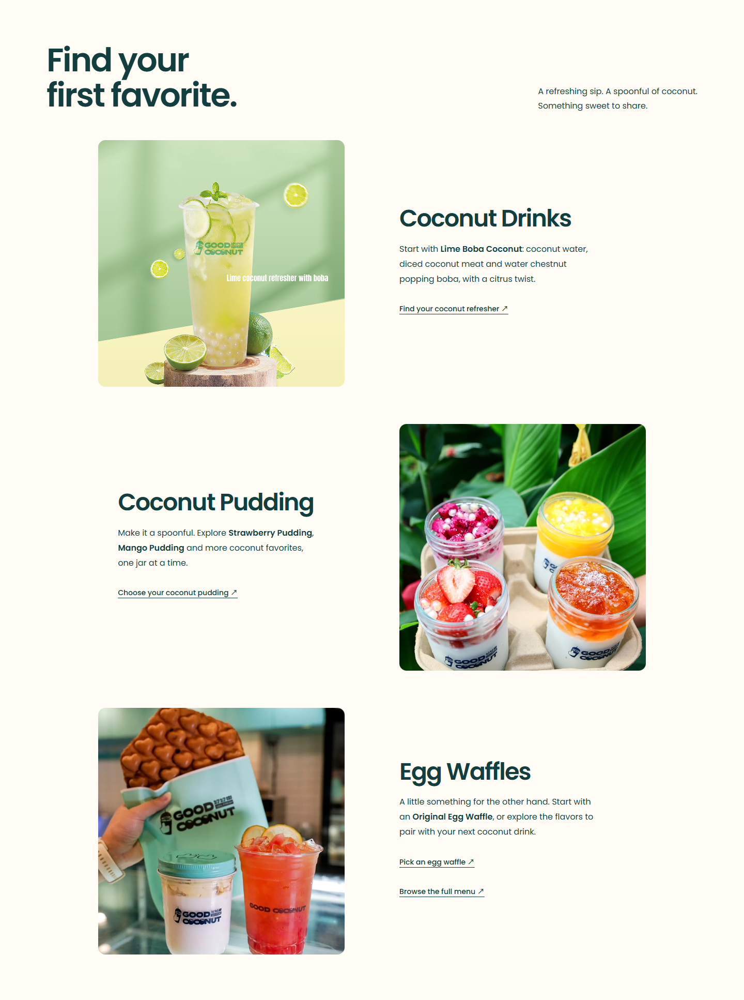
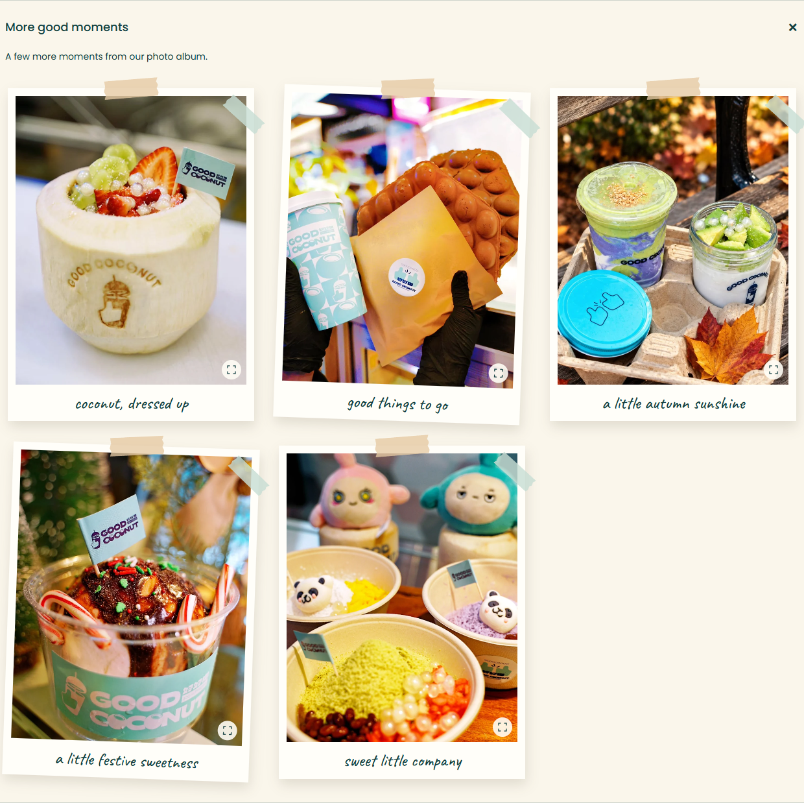
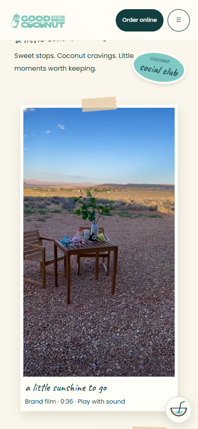

# 首页与真实素材更新

2026-11-06。产品区域提前到品牌故事之前，手机产品主图由约 552px 提前至约 387px（390px 宽度）。保留薄荷绿、奶油白与深青色，统一三张产品图的比例和圆角。

十张用户提供的照片用于产品、品牌故事、Gallery 和按需展开的相册；原有照片带及两排八张拼贴保留。一段完整的 36.47 秒户外品牌花絮替代视频占位，保留原声，手动播放，支持拖动进度，播放前不下载视频。

## 视觉预览

### 手机首页

### 产品区

### 展开相册

### 手机视频播放

## 素材与验证

- 素材位于 `public/assets/moments/`。十张 WebP 合计约 1.17 MB；视频为 H.264/AAC MP4、720×1280、约 10.0 MB。
- 原始素材未修改；源文件不随仓库提交。照片源文件名映射见 [素材清单](../../../qa/real-media/photo-manifest.json)。如需重新生成照片，安装 Pillow 后运行 `python prepare-real-media.py --source <原始PNG目录>`。正常站点构建直接使用已提交素材，不需要 Python。
- `npm run build`、`npm run check`、`npm test` 通过（9 项服务端测试）。
- `node qa-gallery.mjs`：六种宽度、照片放大、键盘焦点、减少动态和无 JavaScript 回退。
- `node qa-critique-update.mjs`：四种宽度、三个产品分类入口、Gallery 锚点及原照片保留。
- `node qa-real-media.mjs`：五种宽度、十张照片、播放前无视频下载、真实播放与拖动至 25 秒、视频失败恢复、可展开相册和无 JavaScript 回退。
- 以上浏览器脚本默认使用本地 4192 端口；先启动预览，也可通过 `QA_BASE` 指定地址。验证在本机 Node 24、Microsoft Edge 上完成；部署配置仍为 Node 22。

对应记录：[真实媒体](../../../qa/real-media/results.json)、[Gallery](../../../qa/gallery/results.json)、[分类入口](../../../qa/critique-update/results.json)。
